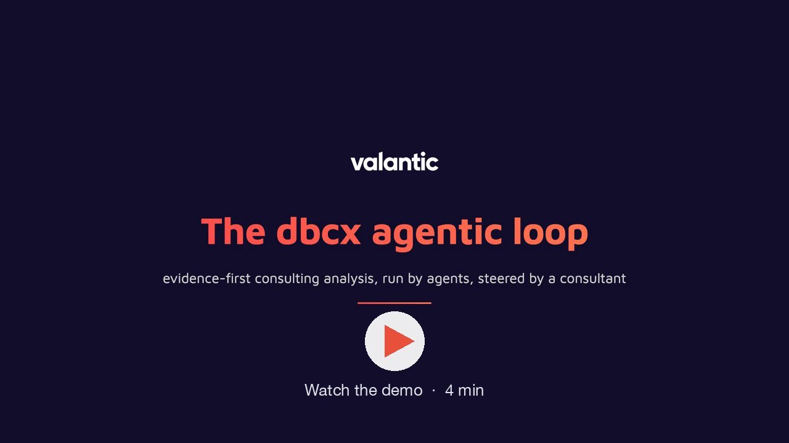

# dbcx-agentic-plugins

Claude Code plugin marketplace of valantic CEC.

## Add the marketplace

In Claude Code:

```
/plugin marketplace add valantic-CEC-Deutschland-GmbH/dbcx-agentic-plugins
```

Then turn on updates once: `/plugin` > **Marketplaces** > `dbcx-agentic-plugins` > **Enable auto-update**. New plugin versions arrive in
the background; open sessions pick them up after `/reload-plugins` or a restart.

In the Claude desktop app or on claude.ai: **Customize > Plugins > Add > Add marketplace**, then enter
`valantic-CEC-Deutschland-GmbH/dbcx-agentic-plugins`.

## Plugins

| Plugin | What it does |
|---|---|
| [dbcx agentic loop](#dbcx-agentic-loop) | Evidence-first agentic analyses for consulting deliverables |

### dbcx agentic loop

An evidence-first agentic loop for consulting deliverables: agents analyse a client's material, critics check every statement against
separate evidence bases, and a final gate reads the result as the client's stakeholders would. Methods: code analysis, enterprise
architecture landscapes, requirements, technology scoring and technology-fit estimation. The results are formula-driven Excel
deliverables, followed on a live run dashboard.

[](https://github.com/valantic-CEC-Deutschland-GmbH/dbcx-agentic-plugins/releases/download/demo-video/agentic-loop-demo.mp4)

Install:

```
/plugin install dbcx-agentic-loop@dbcx-agentic-plugins
```

First steps: say "set up the dbcx plugin" in Claude Code to check Python and the packages the plugin needs, then "onboarding" for a short
tour.

## Releases

Each plugin lives in its own folder under `plugins/`, and every release raises the version in that plugin's `.claude-plugin/plugin.json`.
Releases are published by the maintainer's release tooling only; the files in this repository are not edited by hand.
